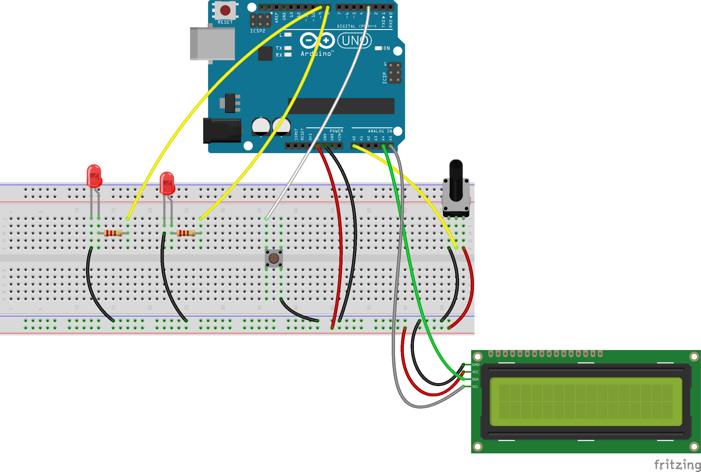
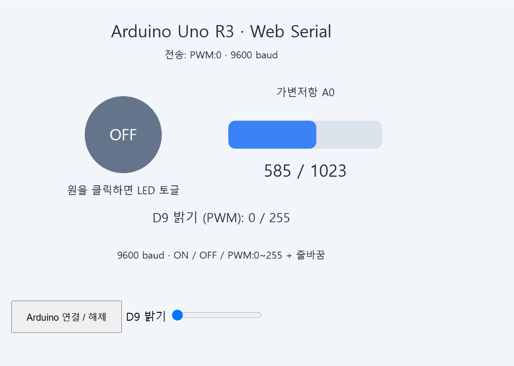
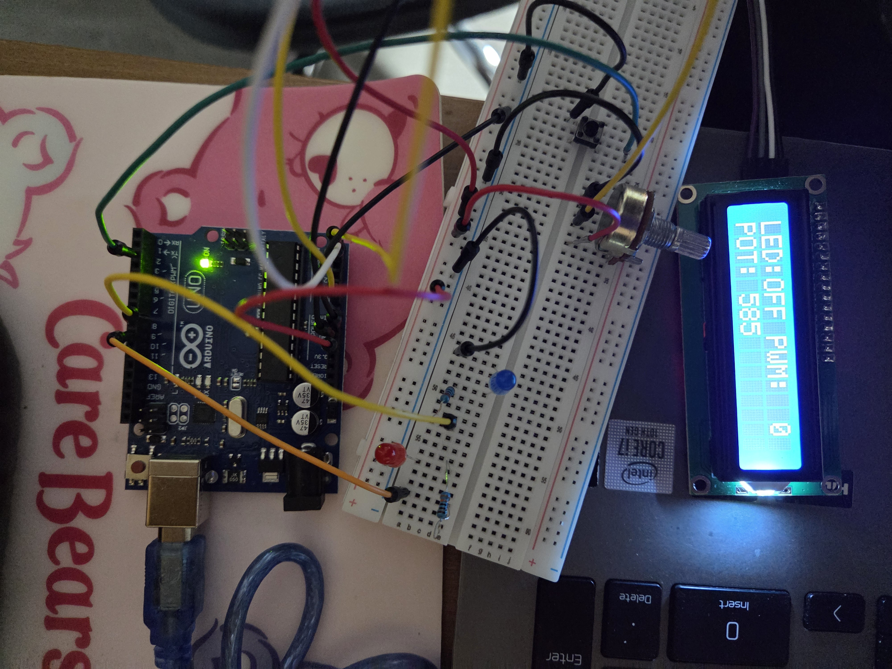
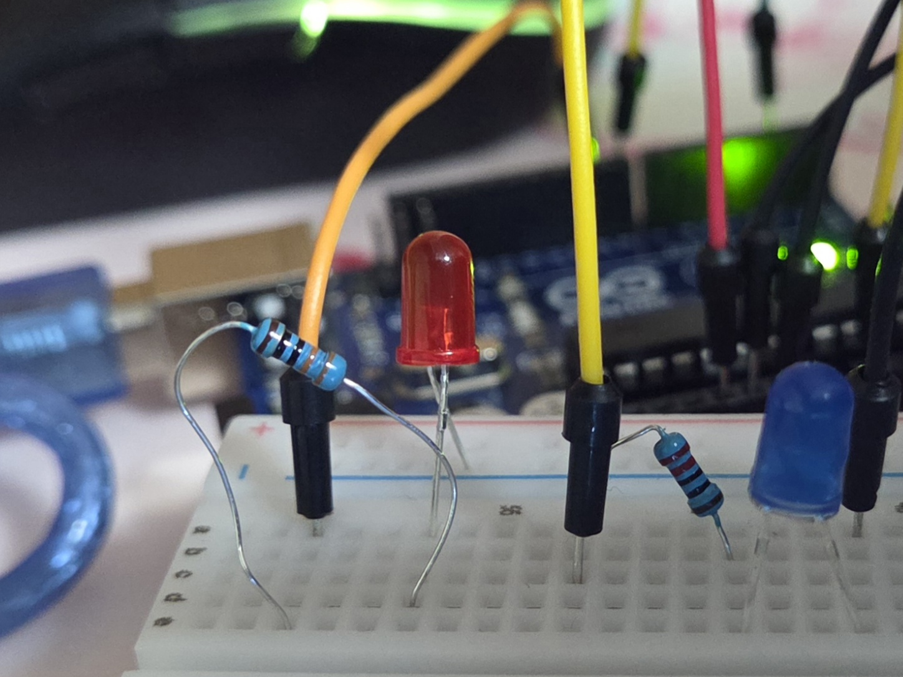
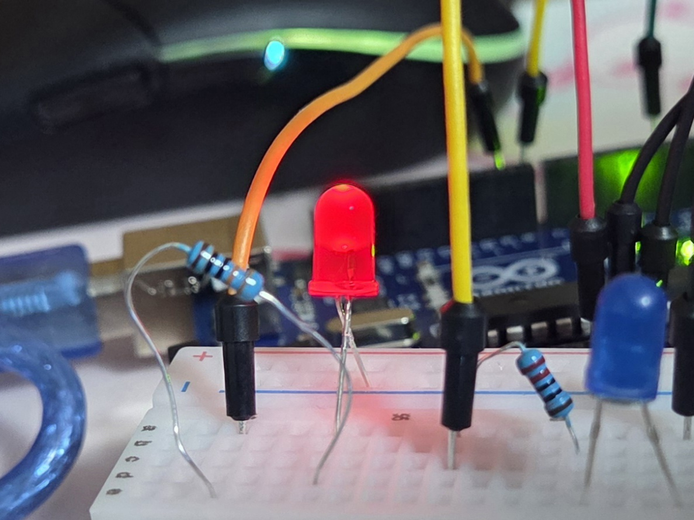
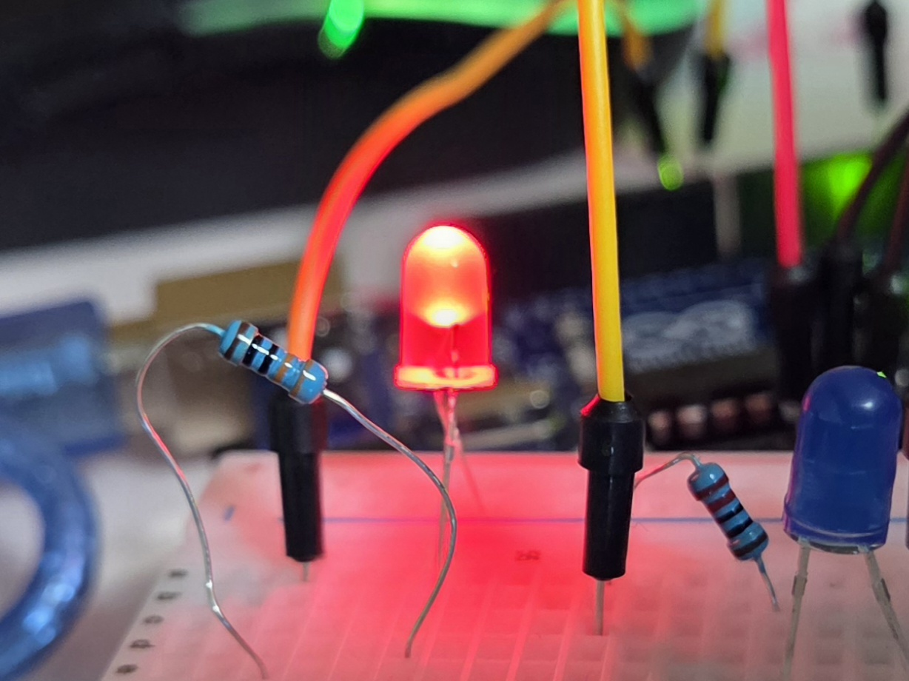

# p5.js 슬라이더로 Arduino LED 밝기 조절하기

웹 브라우저(p5.js)의 슬라이더를 움직이면 **Web Serial**로 Arduino에 값이 전달되고, Arduino는 **PWM** 출력으로 D9에 연결된 LED의 밝기를 바꾸는 프로젝트입니다.

기존 과제(버튼·시리얼 명령으로 D8 LED ON/OFF, 가변저항 값 표시, I2C LCD 출력)에 **D9 밝기 조절 LED**를 추가했습니다.

- p5.js 스케치: [p5 Web Editor 링크](https://editor.p5js.org/bjc97r/sketches/04Ur1M6iy)
- Arduino 코드: [`led_pwm_slider/led_pwm_slider.ino`](led_pwm_slider/led_pwm_slider.ino)
- p5.js 코드: [`p5/sketch.js`](p5/sketch.js), [`p5/serial-helper.js`](p5/serial-helper.js)

---

## 1. 회로 연결도



## 2. 동작 원리

### 통신 방식

```
[p5.js 슬라이더 0~255] --"PWM:128\n"--> [Arduino] --analogWrite(9, 128)--> [D9 LED]
                         <--"PWM: 128"--  (적용한 값을 다시 알려줌)
```

| 방향 | 메시지 | 의미 |
|---|---|---|
| p5 → Arduino | `ON` / `OFF` | D8 LED 켜기 / 끄기 |
| p5 → Arduino | `PWM:0` ~ `PWM:255` | D9 LED 밝기 설정 |
| Arduino → p5 | `LED: ON` / `LED: OFF` | D8 상태 보고 |
| Arduino → p5 | `PWM: 값` | D9 적용 값 보고 |
| Arduino → p5 | `POT: 값` | 가변저항 값 (0~1023) |

모든 메시지는 줄바꿈(`\n`)으로 끝나며, 통신 속도는 9600 baud입니다.

### PWM으로 밝기를 조절하는 원리

Arduino Uno는 실제로 전압을 0~5V 사이로 바꿀 수 없습니다. 대신 **PWM(Pulse Width Modulation)** 으로 5V와 0V를 아주 빠르게(D9 기준 약 490Hz) 번갈아 출력합니다. 이때 한 주기 중 5V인 시간의 비율(**듀티비**)을 바꾸면 평균 전력이 달라지고, 눈에는 LED 밝기가 변하는 것처럼 보입니다.

| `analogWrite` 값 | 듀티비 | 밝기 |
|---|---|---|
| 0 | 0% | 꺼짐 |
| 64 | 약 25% | 어두움 |
| 128 | 약 50% | 중간 |
| 255 | 100% | 최대 |

## 3. 코드 설명

### Arduino

TaskScheduler로 4개의 작업을 주기적으로 실행합니다.

| Task | 주기 | 역할 |
|---|---|---|
| `tButton` | 10ms | 버튼 인터럽트 플래그 확인 → D8 토글 |
| `tPot` | 100ms | 가변저항 측정, 5 이상 변하면 보고 |
| `tSerial` | 20ms | 시리얼 명령 처리 (`ON`, `OFF`, `PWM:값`) |
| `tLCD` | 100ms | LCD에 LED 상태, PWM 값, 가변저항 값 표시 |

추가한 핵심 부분은 `PWM:` 명령 처리입니다.

```cpp
else if (strncmp(command, "PWM:", 4) == 0) {
  int value;
  if (parsePWM(command, value)) {   // 숫자이고 0~255 범위인지 검사
    setPWM(value);                  // analogWrite(9, value)
  }
  else {
    Serial.println("Invalid PWM (0~255)");
  }
}
```

- `parsePWM()`은 숫자가 아니거나 255를 넘는 값을 거부해 잘못된 입력을 막습니다.
- `setPWM()`은 값이 바뀌었을 때만 `analogWrite()`를 호출하고 `PWM: 값`을 보고합니다.
- 슬라이더 반응을 빠르게 하려고 시리얼 처리 주기를 500ms → 20ms로 줄였습니다.
- 명령 버퍼를 8 → 16바이트로 늘려 `PWM:255` 같은 명령도 여유 있게 받습니다.

### p5.js

```js
slider = createSlider(0, 255, 0, 1);   // PWM 값 0~255

function sendPwm() {
  const pwm = slider.value();
  if (!serial.writer || sending || pwm === sentPwm) return;
  sending = true;
  serial.send('PWM:' + pwm).then(ok => {
    if (ok) sentPwm = pwm;
    sending = false;
  });
}
```

- `draw()`에서 매 프레임 `sendPwm()`을 호출하지만, 값이 바뀌었을 때만 전송합니다.
- 이전 전송이 끝나기 전에는 다음 전송을 하지 않아(`sending` 플래그) 명령이 쌓이지 않습니다.
- 다시 연결하면 `sentPwm`을 초기화해 현재 슬라이더 값을 곧바로 보냅니다.
- 시리얼 연결·수신은 `serial-helper.js`의 `SerialHelper` 클래스가 담당합니다.

## 4. 데모

| p5.js 화면 | 실제 회로 |
|---|---|
|  |  |

| 슬라이더 0 | 슬라이더 128 | 슬라이더 255 |
|---|---|---|
|  |  |  |

## 5. 고찰

- **PWM의 이해**: `analogWrite()`라는 이름과 달리 실제로는 아날로그 전압이 아니라 디지털 신호의 켜짐 비율을 바꾸는 방식이라는 것을 알게 되었다. 그래서 PWM을 지원하는 핀(`~`)에만 연결해야 한다.
- **밝기의 비선형성**: 슬라이더 값을 0 → 128로 올렸을 때의 밝기 변화가 128 → 255로 올렸을 때보다 훨씬 크게 느껴졌다. 사람의 눈이 밝기를 선형적으로 느끼지 않기 때문이며, 감마 보정을 적용하면 더 자연스럽게 조절할 수 있을 것이다.
- **응답 속도**: 처음에는 시리얼 처리 주기가 500ms라서 슬라이더를 움직여도 LED가 늦게 반응했다. 주기를 20ms로 줄이자 거의 즉시 반응했다.
- **통신량 관리**: 슬라이더를 빠르게 움직이면 많은 명령이 생기는데, 값이 바뀔 때만 보내고 이전 전송이 끝난 뒤에 다음 값을 보내도록 해서 9600 baud에서도 명령이 밀리지 않게 했다.
- **입력 검증**: `PWM:abc`나 `PWM:300` 같은 잘못된 명령이 들어와도 오작동하지 않도록 Arduino에서 범위를 검사했다.
